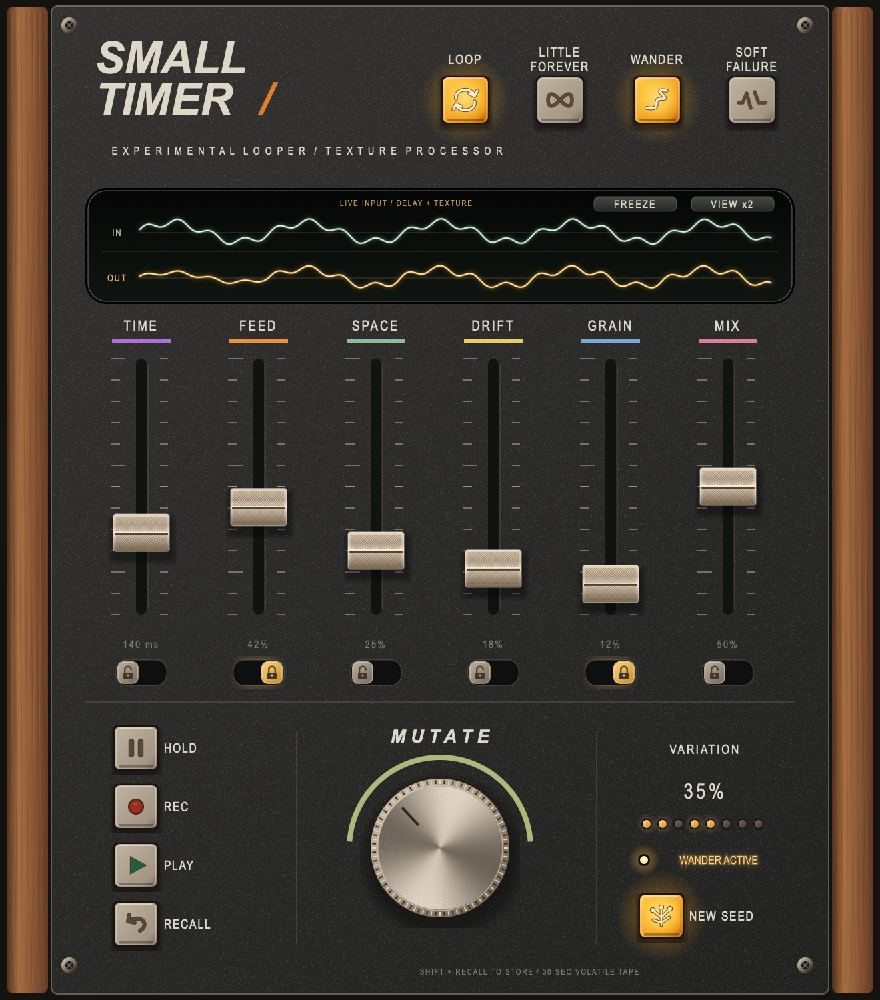

# Small Timer — sound prototype 0.2.2

JUCE 8 / macOS 12+ audio effect, built as Audio Unit, VST3 and standalone.
The 660 × 750 panel is painted natively: charcoal aluminum, walnut rails,
metal fader caps, illuminated switches and two stacked waveform lanes.
Pale green IN on top shows the source before effects; amber OUT below shows the final output.
Both lanes share the same time and amplitude scale (left channel, +/-1.25 at VIEW x1).
During RAM playback the source trace follows the recorded loop, not live input.
At MIX zero the lanes show identical shapes, remaining separately visible.
The monitor shows the latest 256 sample
pairs, decimated once per 128 audio samples, in chronological order.



This repository contains source and tests, not prebuilt plugins or JUCE itself.

## Build

Requires Xcode command-line tools, CMake 3.22+ and a JUCE 8 checkout.

```sh
cmake -S . -B build -DJUCE_PATH=/absolute/path/to/JUCE -DCMAKE_BUILD_TYPE=Release
cmake --build build -j 4
ctest --test-dir build --output-on-failure
```

Bundles appear in `build/SmallTimer_artefacts/Release/` under `AU`, `VST3`
and `Standalone`. Builds do not automatically install plugins. Copy the
`.component` or `.vst3` to your user's Audio/Plug-Ins folder when ready.
The standalone's Options menu configures audio input/output. Use headphones
when monitoring a microphone. JUCE's applicable licensing terms apply.
The supplied binaries target Apple silicon (arm64); Intel builds require a
separate configure using `-DCMAKE_OSX_ARCHITECTURES=x86_64`, or use
`-DCMAKE_OSX_ARCHITECTURES="arm64;x86_64"` for a universal build.

For optional tests that load the actual AU and VST3 bundles in a JUCE host:

```sh
SMALL_TIMER_BUNDLE_ROOT="$PWD/build/SmallTimer_artefacts/Release" \
    build/SmallTimerTests_artefacts/Release/SmallTimerTests
```

These tests need access to macOS audio component services. The AU is registered
only within the test process; no system plugin installation is performed.
All bundles receive a local ad-hoc signature after packaging. They are development
builds, without Developer ID signing or notarization.

## Play

- LOOP and LITTLE FOREVER each retain six independent fader settings.
- TIME sets a continuously variable 40 ms–2 second tape-style delay.
- FEED controls repeats: Loop ranges from a single echo to strong feedback;
  Little Forever uses higher feedback for much longer, gently decaying repeats.
- SPACE adds a damped, diffuse stereo ambience after the delay.
- DRIFT introduces slow tape wow and flutter, including stereo variation.
- GRAIN blends two overlapping, windowed delay voices for a granular texture.
- MIX blends dry and wet audio. Zero is exact dry audio; 100% is only the effect.
- Switching mode, recalling or mutating moves the faders smoothly at 60 Hz.
- WANDER enables slow, bounded audible motion. MUTATE sets its depth.
- Drag a fader to take over immediately; Wander waits 1.5 seconds after release.
- Each miniature padlock latch excludes its fader from Wander, mutation and recall when locked (amber thumb on the right). Manual edits and
  switching mode remain available. Locks apply to both modes.
- HOLD freezes motor movement; manual edits remain available. Release to resume.
  Delay and audio playback continue while held; HOLD does not freeze audio.
- NEW SEED applies a random mutation to unlocked settings in the current mode.
- RECALL restores that mode's stored snapshot. Shift-click RECALL to store it.
  Initial snapshots use factory settings. Double-click a fader for its mode default.
- REC captures up to 30 seconds of live audio in RAM. Click again to finish.
  A new recording replaces the old one. PLAY loops it in place of live input;
  click PLAY again to return to live input. Both sources pass through the effects.
  PLAY also finishes recording. Recording captures the input before effects so
  you can reshape the same recording with the faders.
- SOFT FAILURE adds darker, saturated repeats and slow wear in the feedback path.
- VIEW cycles shared x1/x2/x4/x8 waveform magnification without changing audio.
  It opens at x2; large signals may reach the visual limits without clipping sound.
- FREEZE holds both displayed waveforms for inspection, not the audio. VIEW still
  works while frozen. Click again to resume the latest live history. Both display
  controls reset when the editor reopens and are not saved or automated.
- Engraved top switches glow when active; WANDER breathes gently. Transport
  symbols identify HOLD, REC, PLAY and RECALL. NEW SEED triggers a short amber
  spark and variation-lamp ripple; the lamp row otherwise indicates MUTATE depth.

## Try it

Load Small Timer after an instrument or audio track in Unfold. Play a short note,
raise FEED, then switch to LITTLE FOREVER. Add SPACE for a longer stereo cloud,
DRIFT for pitch movement and GRAIN for texture. Turn MIX down to hear more of
the original signal. You can also record a short phrase and reshape its RAM loop.

Reload the plugin instance or restart the host after installing an update:
already-open instances keep the old code
in memory. Existing 0.1.0 parameter settings and recall snapshots are compatible.

## Prototype boundaries

This is a first sound engine, not a hardware circuit emulation. Moving TIME
glides the delay head and intentionally changes pitch. Little Forever decays
rather than sustaining perfectly forever. There is no tempo sync or saved audio.
RAM playback is a basic loop without seam crossfades. The feedback path has
damping, DC removal and saturation; the wet output is softly bounded.
Wander runs on the audio thread even with the editor closed, around the saved
targets without overwriting them or writing automation. The panel follows those
audible positions; when audio is stopped, it previews motor motion locally.
Controls are smoothed to reduce clicks. The waveform is a decimated output
monitor, not a stored waveform editor. Dry input gain is preserved, not limited.

Host state contains only named parameters: both mode banks, both recall
snapshots, locks, mode, motion, hold, soft failure and mutation depth. Audio,
transport, motor positions and Wander phase are never serialized. Preparing
the device or reopening the plugin clears the temporary recording.

The panel follows the supplied boutique-hardware reference, with native-painted
controls rather than an exact photographic reproduction. See DESIGN_UPDATE.md
for the interface revisions and TEST_REPORT.md for validation details.
